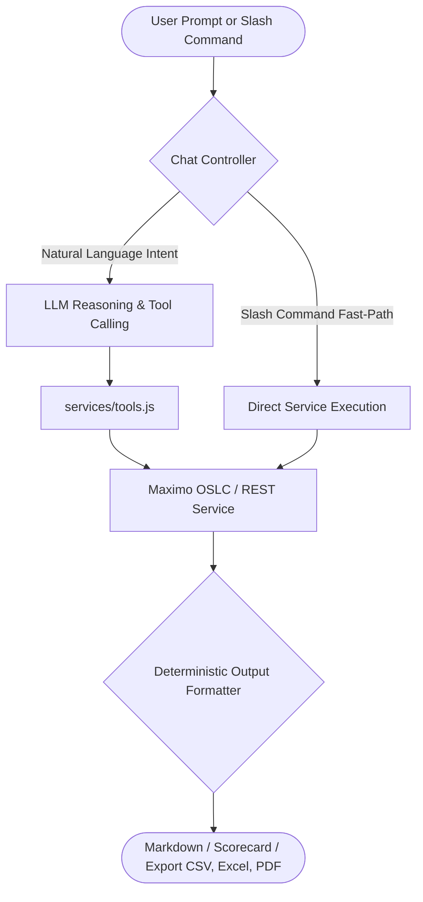

# Enterprise Maximo Agent — Complete Skills & Capabilities Catalog

> **Overview**: This catalog documents all 12 active persona-driven skills integrated into Eden Copilot (`maximo-agent`), covering 56 executable Maximo EAM tools, ISO 55000 / ISO 14224 compliance frameworks, multi-server federation, site-specific maintenance KPI scorecards, and multi-persona workflows.

---

## 📊 Summary by Persona & Slash Commands

| Skill ID | Name | Persona | Slash Commands | Primary Purpose |
| :--- | :--- | :--- | :--- | :--- |
| **`client-portal`** | **Tenant & Client Service Portal** | **Tenant / Client / FM Service Desk** | `/request`, `/my-tickets` | **Submit service requests and track Service Requests (SRs) from `/MXSR` with friendly stage mapping, site filtering, and period horizons.** |
| **`site-reliability-kpis`** | Site Reliability & Maintenance KPIs | Executive / Maintenance Manager | `/site-kpis`, `/cm-ratio`, `/pm-compliance`, `/site-mtbf`, `/site-backlog` | Direct site KPI scorecard computing CM Ratio, PM Compliance %, Active Backlog, MTTR, MTBF, and Equipment Availability over 7d, 30d, 90d, 180d, 365d, or all-time. |
| **`iso55000-kpi-governance`** | ISO 55000 EAM KPI Governance | Executive / Reliability | `/iso-kpi-sql`, `/iso-reliability-kpi`, `/iso-work-kpi`, `/iso-financial-kpi`, `/iso-inventory-kpi`, `/iso-governance-audit`, `/propose-capa` | ISO 55001 asset management compliance, KPI monitoring, Db2 SQL queries, and corrective action logging. |
| **`fmea-rcm-modeling`** | FMEA & RCM Failure Modeling | Reliability Engineer | `/fmea-rpn`, `/iso14224-hierarchy`, `/rcm-decision`, `/propose-fmea-jobplan` | Failure Mode and Effects Analysis (FMEA), ISO 14224 failure hierarchies, RPN calculation, and RCM strategy formulation. |
| **`eam-reliability-governance`** | EAM Reliability & Asset Governance | Reliability Engineer | `/reliability-kpis`, `/asset-criticality`, `/failure-hierarchy`, `/build-oslc-query`, `/propose-pm-freq` | Asset criticality matrix, MTBF/MTTR analytics, PM frequency optimization, and direct OSLC query generation. |
| **`executive-federation`** | Multi-Instance Federation | Executive | `/portfolio-summary`, `/federated-assets` | Unified cross-instance portfolio health and asset count across all distributed Maximo production servers. |
| **`executive-capex`** | Capex & Replacement Planning | Executive | `/capex`, `/board-memo`, `/league` | Asset replacement forecasting, end-of-life analysis, executive board memos, and site ranking. |
| **`executive-finance`** | Maintenance Cost & Budget | Executive | `/budget-variance`, `/cost-summary` | High-level financial reporting, budget vs actual variance tracking, and cost breakdowns. |
| **`executive-risk-matrix`** | Asset Risk & Backlog Aging | Executive | `/risk-matrix`, `/backlog-aging` | 5x5 risk matrix scoring, safety/environmental exposure, and overdue work order aging. |
| **`engineer-rca`** | Root Cause Analysis & Optimization | Reliability Engineer | `/rca`, `/bad-actors`, `/optimize-pm` | 5-Whys root cause investigation, top 10 repetitive failure identification, and PM program optimization. |
| **`manager-audit`** | Audit, Compliance & SLA | Facility Manager | `/audit`, `/vendor-sla`, `/stock-forecast` | PM audit compliance, vendor contract SLA tracking, and critical spare parts replenishment forecasting. |
| **`technician-troubleshoot`** | Field Troubleshooting & Safety | Field Technician | `/troubleshoot`, `/safety`, `/finish-wo` | Interactive equipment diagnosis, step-by-step safety permits (LOTO/JSA), and mobile work order closure. |

---

## 1. Client Service Request Portal (`client-portal`)
- **Persona**: Tenant / Client / Non-Technical User / Helpdesk
- **Description**: Streamlined interface for reporting facility issues and monitoring ticket resolution directly against the Maximo Service Desk (`/MXSR`).
- **Slash Commands**:
  - `/request <description>`: Automatically formats and submits an official Maximo Service Request (SR).
  - `/my-tickets [site=<SITE>] [period=<PERIOD>]`: Queries real Maximo Service Requests (`/MXSR`), maps technical statuses to user-friendly progress stages (Received & Queued, Technician Working, Completed, Closed), and filters by site and period (`7d`, `30d`, `90d`, `180d`, `365d`, `all`).
- **Associated Tools**: `create_service_request`, `get_service_requests`, `get_service_request_count`, `get_maximo_work_orders`.

---

## 2. Site Reliability & Maintenance KPIs (`site-reliability-kpis`)
- **Persona**: Executive / Maintenance Director / Facility Lead
- **Description**: Evaluates and benchmarks operational and reliability KPIs directly for any Maximo facility site over flexible observation periods (`7d`, `30d`, `90d`, `180d`, `365d`, `all`).
- **Slash Commands**:
  - `/site-kpis [site=<SITEID>] [period=<PERIOD>]`: Compiles comprehensive Site KPI scorecard with CM Ratio, PM Compliance %, Active Backlog, MTTR, MTBF, Inherent Availability %, and Top Bad Actor assets.
  - `/cm-ratio [site=<SITEID>] [period=<PERIOD>]`: Evaluates Corrective Maintenance workload vs total maintenance orders (Target $< 20\%$).
  - `/pm-compliance [site=<SITEID>] [period=<PERIOD>]`: Measures on-time PM execution compliance (Target $\ge 90\%$).
  - `/site-mtbf [site=<SITEID>] [period=<PERIOD>]`: Calculates Mean Time Between Failures and equipment availability.
  - `/site-backlog [site=<SITEID>]`: Evaluates open work order backlog volume (`WAPPR`, `APPR`, `INPRG`).
- **Associated Tools**: `get_site_kpi_scorecard`, `get_multi_site_reliability_league`, `get_reliability_metrics`.

---

## 3. ISO 55000 EAM KPI Governance (`iso55000-kpi-governance`)
- **Persona**: Executive / Reliability Manager / Compliance Auditor
- **Description**: Implements asset governance aligned with ISO 55000 / ISO 55001. Provides direct Maximo SQL KPI generation, work management metrics, reliability availability figures, inventory turns, compliance audits, and automated CAPA work order logging.
- **Slash Commands**:
  - `/iso-kpi-sql <KPI_NAME>`: Returns verified DB2/Oracle SQL queries mapped to standard Maximo schemas (`WORKORDER`, `ASSET`, `MATUSETRANS`, `INVENTORY`).
  - `/iso-reliability-kpi`: Evaluates MTBF, MTTR, Availability, and OEE.
  - `/iso-work-kpi`: Evaluates PM compliance, proactive vs reactive ratio, and schedule compliance.
  - `/iso-financial-kpi`: Evaluates Asset Replacement Value (RAV), maintenance cost ratios, and budget variances.
  - `/iso-inventory-kpi`: Evaluates inventory turnover ratio, inactive stock value, and stockout percentages.
  - `/iso-governance-audit [siteid]`: Runs an automated compliance audit against ISO 55001 clauses 6.2, 8.1, 9.1, and 10.2.
  - `/propose-capa`: Drafts and logs a formal Maximo Corrective Action Plan (CAPA) work order when KPI thresholds are breached.
- **Associated Tools**: `get_iso55000_kpi_sql`, `calculate_reliability_availability_kpis`, `calculate_work_management_kpis`, `calculate_maintenance_financial_kpis`, `calculate_inventory_mro_kpis`, `run_iso55001_governance_audit`, `propose_iso55001_capa_action`.

---

## 4. FMEA & RCM Failure Modeling (`fmea-rcm-modeling`)
- **Persona**: Reliability Engineer / Asset Strategy Specialist
- **Description**: Systematic reliability analysis following ISO 14224 taxonomies and SAE JA1011/1012 standards. Calculates Risk Priority Numbers (RPN), standardizes failure hierarchies (Problem-Cause-Remedy), guides RCM decision logic, and drafts condition-based PM job plans.
- **Slash Commands**:
  - `/fmea-rpn`: Calculates Severity × Occurrence × Detection (RPN) and assigns criticality classifications.
  - `/iso14224-hierarchy <equipment_class>`: Generates standardized ISO 14224 component, failure mechanism, and remedy codes.
  - `/rcm-decision`: Runs decision-tree logic to determine maintenance strategy (Condition-based, Time-based, Run-to-Failure, Redesign).
  - `/propose-fmea-jobplan`: Creates a comprehensive PM Job Plan with tasks, craft qualifications, safety requirements, and spare parts.
- **Associated Tools**: `calculate_fmea_rpn`, `get_iso14224_failure_hierarchy`, `evaluate_rcm_strategy`, `propose_fmea_derived_jobplan`.

---

## 5. EAM Reliability & Asset Governance (`eam-reliability-governance`)
- **Persona**: Reliability Engineer / Maintenance Planner
- **Description**: Advanced engineering workflows for asset lifecycle optimization, PM interval evaluation, criticality matrices, and raw OSLC queries.
- **Slash Commands**:
  - `/reliability-kpis [assetnum]`: Retrieves MTBF, MTTR, availability metrics, and failure counts.
  - `/asset-criticality [assetnum]`: Calculates asset criticality index based on safety, production, environmental, and financial impacts.
  - `/failure-hierarchy [classstructureid]`: Retrieves failure codes, problems, causes, and remedies.
  - `/build-oslc-query <oslc_resource> [query_params]`: Constructs and tests Maximo OSLC REST queries (e.g. `mxapiwodetail`, `mxapiasset`).
  - `/propose-pm-freq [pmnum]`: Proposes adjusted preventive maintenance frequencies based on actual operating history.
- **Associated Tools**: `get_asset_reliability_kpis`, `calculate_asset_criticality`, `get_failure_hierarchy`, `build_maximo_oslc_query`, `propose_pm_frequency_adjustment`.

---

## 6. Multi-Instance Federation (`executive-federation`)
- **Persona**: Executive / VP of Operations / Enterprise Asset Director
- **Description**: Consolidates multi-instance Maximo environments across separate enterprise URLs, physical servers, and distributed plant instances.
- **Slash Commands**:
  - `/portfolio-summary`: Provides high-level portfolio overview across all active server instances (total assets, open work orders, critical backlog).
  - `/federated-assets [status]`: Queries and aggregates asset inventory counts across all active Maximo instances simultaneously.
- **Associated Tools**: `get_federated_portfolio_summary`, `get_federated_asset_count`.

---

## 7. Capex & Replacement Planning (`executive-capex`)
- **Persona**: Executive / Chief Financial Officer / Asset Director
- **Description**: Capital expenditure planning, 5-year asset replacement forecasting, and multi-site reliability league tables.
- **Slash Commands**:
  - `/capex [siteid]`: Identifies assets exceeding operational design life and estimates replacement costs.
  - `/board-memo`: Generates executive summaries on fleet health, urgent capital risks, and recommended budget allocations.
  - `/league`: Compares facility sites across compliance, PM completion, emergency work ratios, and reliability indices.
- **Associated Tools**: `get_capex_replacement_forecast`, `generate_board_memo`, `get_site_league_table`.

---

## 8. Maintenance Cost & Budget (`executive-finance`)
- **Persona**: Executive / Finance Director / Maintenance Manager
- **Description**: Financial governance, real-time budget variance tracking, and maintenance spend analytics.
- **Slash Commands**:
  - `/budget-variance [siteid]`: Compares actual maintenance labor, material, and service costs against annual budgets.
  - `/cost-summary [siteid]`: Detailed cost breakdown by asset class, location, and work type (Corrective vs Preventive).
- **Associated Tools**: `get_budget_variance`, `get_cost_summary`.

---

## 9. Asset Risk & Backlog Aging (`executive-risk-matrix`)
- **Persona**: Executive / Risk & Compliance Director
- **Description**: Enterprise risk exposure analysis and work backlog health monitoring.
- **Slash Commands**:
  - `/risk-matrix [siteid]`: Evaluates assets on a 5x5 Consequence vs Probability risk matrix.
  - `/backlog-aging [siteid]`: Analyzes overdue work orders segmented into 30, 60, 90, and 120+ day aging buckets.
- **Associated Tools**: `get_asset_risk_matrix`, `get_backlog_aging`.

---

## 10. Root Cause Analysis & Optimization (`engineer-rca`)
- **Persona**: Reliability Engineer
- **Description**: Deep-dive failure investigation, recurring failure detection, and PM program rationalization.
- **Slash Commands**:
  - `/rca <wonum>`: Conducts structured 5-Whys root cause investigation using Maximo work order history and failure data.
  - `/bad-actors [siteid]`: Surfaces top 10 assets incurring highest downtime, repeat work orders, and maintenance expenditures.
  - `/optimize-pm [siteid]`: Identifies redundant or non-value-adding PM tasks and recommends interval adjustments.
- **Associated Tools**: `conduct_root_cause_analysis`, `get_bad_actors`, `optimize_pm_program`.

---

## 11. Audit, Compliance & SLA (`manager-audit`)
- **Persona**: Maintenance Manager / Facility Manager
- **Description**: Operational governance, regulatory compliance verification, vendor performance, and spare parts supply chain health.
- **Slash Commands**:
  - `/audit [siteid]`: Evaluates regulatory compliance, PM adherence, safety records, and overdue statutory inspections.
  - `/vendor-sla [vendor]`: Evaluates contractor response times, completion rates, and service agreement compliance.
  - `/stock-forecast [itemnum]`: Evaluates MRO inventory levels, reorder points, and lead-time depletion risks.
- **Associated Tools**: `get_audit_compliance`, `get_vendor_sla_performance`, `forecast_stock_depletion`.

---

## 12. Field Troubleshooting & Safety (`technician-troubleshoot`)
- **Persona**: Field Technician / Maintenance Lead
- **Description**: Tactical field support, symptom-based diagnosis, safety permits, and rapid work order closeout.
- **Slash Commands**:
  - `/troubleshoot <assetnum> [symptom]`: Step-by-step diagnostic guide based on symptom patterns and historical repairs.
  - `/safety <wonum>`: Generates mandatory safety checklists, Lockout/Tagout (LOTO) procedures, and PPE requirements.
  - `/finish-wo <wonum>`: Quick-closes completed work orders with labor hours, materials used, and failure codes.
- **Associated Tools**: `troubleshoot_asset`, `get_safety_precautions`, `complete_work_order`.

---

## ⚙️ Architecture & Execution Pipeline

